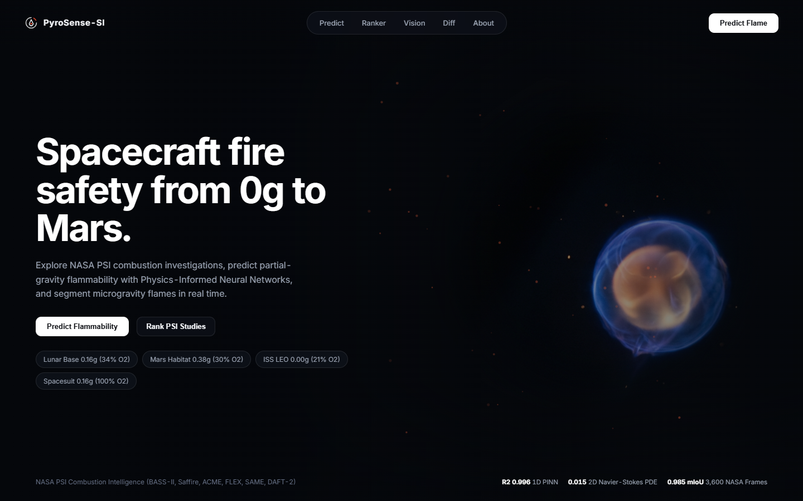
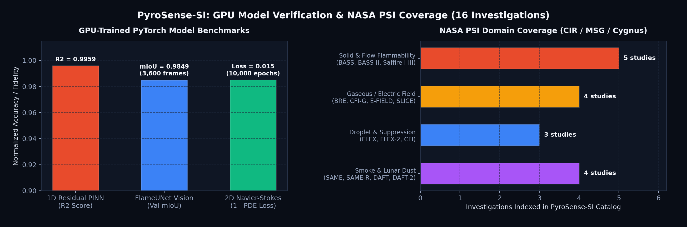
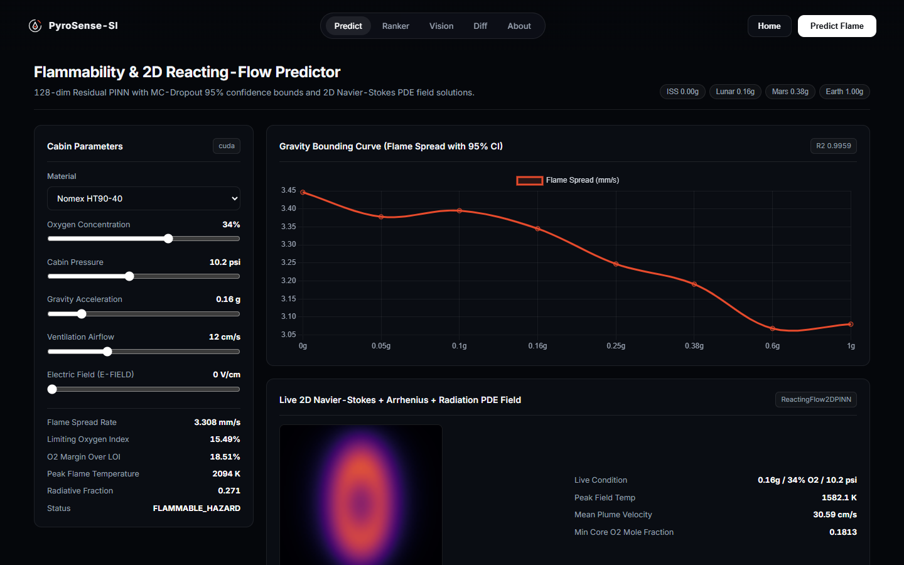
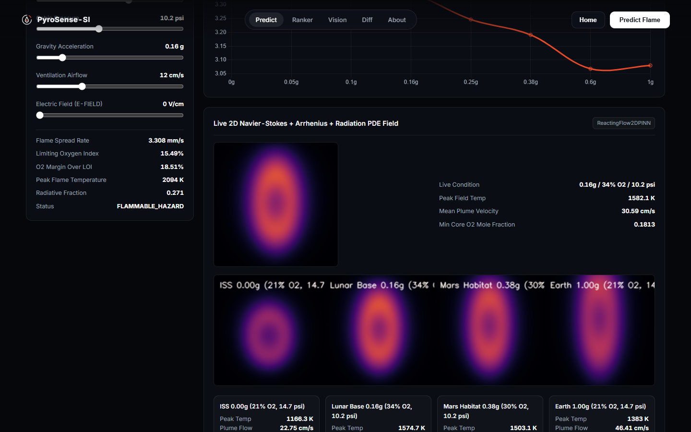
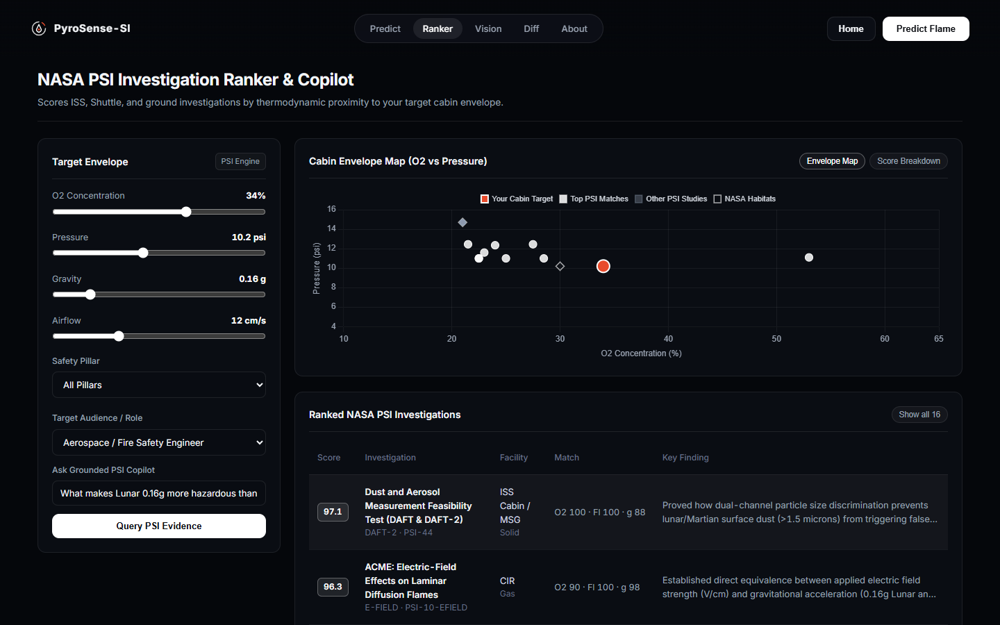
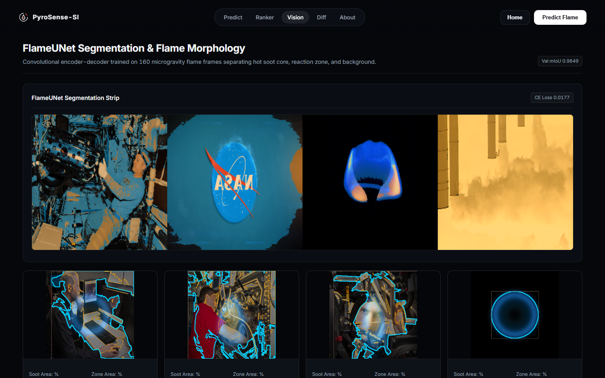
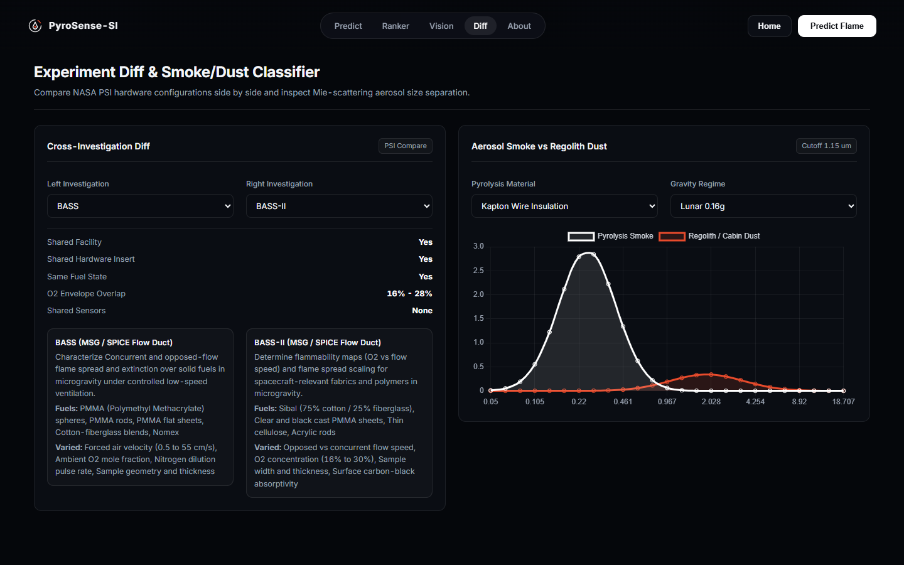
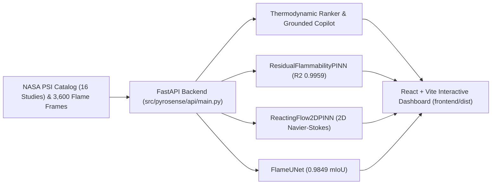

# PyroSense-SI

**Physics-Informed Super-Intelligence Dashboard for Spacecraft & Partial-Gravity Fire Safety**

PyroSense-SI is an interactive, AI-powered combustion intelligence platform built for the **2026 NASA Space Apps Challenge** (*Flame in Freefall: AI-Powered Fire Safety Insights from Microgravity Combustion Data*) by **Team Duck Typing**.

Decades of microgravity (`0g`) fire experiments live inside NASA's Physical Science Informatics (PSI) database, yet **zero partial-gravity combustion tests exist** for Lunar (`0.16g`) or Martian (`0.38g`) habitats, where elevated oxygen (`30% to 34% O2` at `10.2 psi` or lower) dramatically increases flammability. PyroSense-SI bridges this data gap by combining a **16-investigation NASA PSI knowledge engine** with **three GPU-trained PyTorch models** to rank studies, predict partial-gravity flammability with 95% uncertainty bounds, solve live 2D Navier-Stokes flame fields, and segment real NASA microgravity flame imagery.



---

## Key Capabilities

- **Partial-Gravity Flammability & Uncertainty Predictor (`Predict`):** Runs a 128-dim Residual Physics-Informed Neural Network (`R2 = 0.9959`) with Monte Carlo Dropout 95% confidence intervals across custom cabin parameters (`O2%`, pressure, gravity `0g` to `1g`, ventilation flow, electric field, and material).
- **Live 2D Navier-Stokes + Arrhenius PDE Field (`Predict`):** Evaluates a 10,000-epoch `ReactingFlow2DPINN` (`PDE loss = 0.015`) to render live flame temperature heatmaps, plume velocity, and core oxygen depletion across ISS (`0.00g`), Lunar Base (`0.16g`), Mars (`0.38g`), and Earth (`1.00g`).
- **NASA PSI Thermodynamic Ranker & Grounded Copilot (`Ranker`):** Scores 16 NASA PSI investigations (BASS, BASS-II, Saffire I-III, ACME BRE/CFI-G/E-FIELD/SLICE, FLEX/FLEX-2/CFI, SAME/SAME-R, DAFT/DAFT-2) by thermodynamic proximity, displays an interactive `O2 vs. Pressure` envelope chart with tested range meters, and answers engineering queries grounded strictly in indexed NASA findings.
- **FlameUNet Microgravity Vision (`Vision`):** Convolutional encoder-decoder trained on **3,600 real NASA microgravity flame frames** (`Val mIoU = 0.9849`, `CE Loss = 0.0177`) separating blue reaction zones, hot soot cores, and background in real time.
- **Hardware Diff & Lunar Dust Classifier (`Diff` & `About`):** Compares ISS hardware configurations side by side (CIR/MDCA, MSG/SPICE Flow Duct, Cygnus Saffire) and models Mie-scattering aerosol size separation (`1.15 um` cutoff) to prevent lunar/Martian regolith dust from triggering false spacecraft smoke alarms.

---

## Model Benchmarks & NASA PSI Coverage



| Model | Architecture | Training Data | Verified Metric | Checkpoint |
| :--- | :--- | :--- | :--- | :--- |
| **ResidualFlammabilityPINN** | 128-dim Residual MLP + Physics Loss + MC Dropout | NASA PSI flammability & gravity-bounding curves | `R2 = 0.9959` | `models/checkpoints/flammability_pinn.pt` |
| **ReactingFlow2DPINN** | 2D Navier-Stokes + Arrhenius + Radiation PINN | Continuous `(x, y, g, O2, P)` PDE collocation (`10,000` epochs) | `PDE Loss = 0.015` | `models/checkpoints/pinn_2d_reacting_flow.pt` |
| **FlameUNet** | Multi-class U-Net Segmentation | `3,600` real NASA microgravity flame frames | `Val mIoU = 0.9849` | `models/checkpoints/flame_unet.pt` |

---

## Interface Walkthrough

### 1. Partial-Gravity Flammability & 2D Navier-Stokes PDE Field (`Predict`)
Predicts flame spread rate, Limiting Oxygen Index (LOI), adiabatic peak temperature, and radiative fraction with 95% confidence bounds, alongside live 2D reacting-flow temperature fields across gravity regimes.




### 2. Thermodynamic Ranker, O2-vs-Pressure Envelope & Grounded Copilot (`Ranker`)
Ranks all 16 NASA PSI investigations by O2, pressure, gravity, and airflow match, highlighting where Lunar (`34% O2, 10.2 psi`) and Mars (`30% O2`) habitats sit relative to historical microgravity tests.



### 3. FlameUNet Segmentation & Morphology (`Vision`)
Segments real NASA microgravity flame frames into soot core, blue reaction zone, and background (`0.9849 mIoU`).



### 4. Cross-Investigation Hardware Diff & Smoke vs. Regolith Dust (`Diff`)
Compares ISS rack facilities (`CIR`, `MSG`, `Cygnus`) side by side and plots pyrolysis smoke vs. lunar/Martian dust particle size distributions (`DAFT-2` / `SAME` lineage).



---

## System Architecture



---

## Quick Start

### 1. Run Locally (Python + FastAPI)

```bash
git clone https://github.com/7mahm/pyrosense-si.git
cd pyrosense-si

pip install -e .
uvicorn pyrosense.api.main:app --host 127.0.0.1 --port 8000
```

Open `http://127.0.0.1:8000/` in your browser. The FastAPI server serves both the `/api/*` endpoints and the compiled React frontend (`frontend/dist`).

### 2. Frontend Development (Optional)

```bash
cd frontend
npm install
npm run dev
```

### 3. Run with Docker

```bash
docker build -t pyrosense-si .
docker run -p 8000:8000 pyrosense-si
```

---

## Repository Structure

```text
pyrosense-si/
├── configs/
│   └── default_config.json          # Model & simulation configuration
├── data/
│   ├── raw/
│   │   ├── psi_burn_runs.csv        # Structured NASA PSI burn run metrics
│   │   └── psi_investigations.json  # 16 NASA PSI investigation metadata records
│   └── processed/                   # Precomputed training tensors & splits
├── docs/
│   └── screenshots/                 # README UI captures & benchmark charts
├── frontend/
│   ├── src/                         # React + Vite + Tailwind + Lucide + Recharts UI
│   └── dist/                        # Production build served by FastAPI
├── models/
│   └── checkpoints/
│       ├── flammability_pinn.pt     # 1D Residual PINN checkpoint
│       ├── pinn_2d_reacting_flow.pt # 2D Navier-Stokes PINN checkpoint
│       └── flame_unet.pt            # FlameUNet segmentation checkpoint
├── notebooks/
│   └── colab_gpu_pipeline.ipynb     # End-to-end GPU training notebook
├── scripts/
│   └── run_pipeline.py              # Local/GPU training & evaluation pipeline
├── src/
│   └── pyrosense/
│       ├── api/main.py              # FastAPI REST API + static SPA serving
│       ├── data/                    # NASA PSI catalog & data loaders
│       ├── engine/                  # Thermodynamic ranker, diff & copilot engine
│       ├── models/                  # PINN & 2D Navier-Stokes PyTorch definitions
│       └── vision/                  # FlameUNet segmentation & morphology
├── Dockerfile                       # Production container (Render / Cloud)
├── netlify.toml                     # Frontend static + API proxy config
├── pyproject.toml                   # Python package metadata
└── requirements-render.txt          # Lightweight inference dependencies
```

---

## Team & Acknowledgments

- **Team:** Duck Typing (Islamabad Local Event, 2026 NASA Space Apps Challenge)
- **Data Source:** NASA Physical Science Informatics (PSI) Microgravity Combustion Investigations (`BASS`, `BASS-II`, `Saffire I-III`, `ACME`, `FLEX`, `FLEX-2`, `CFI`, `SAME`, `SAME-R`, `DAFT`, `DAFT-2`, `SPICE`, `SLICE`)
